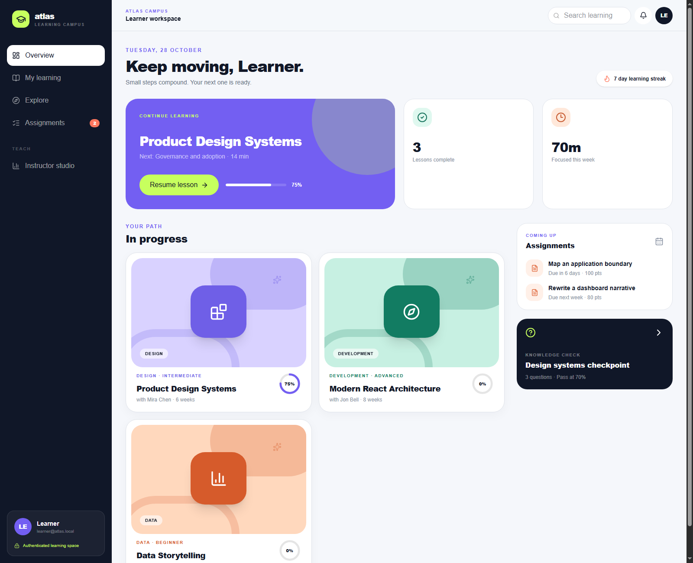
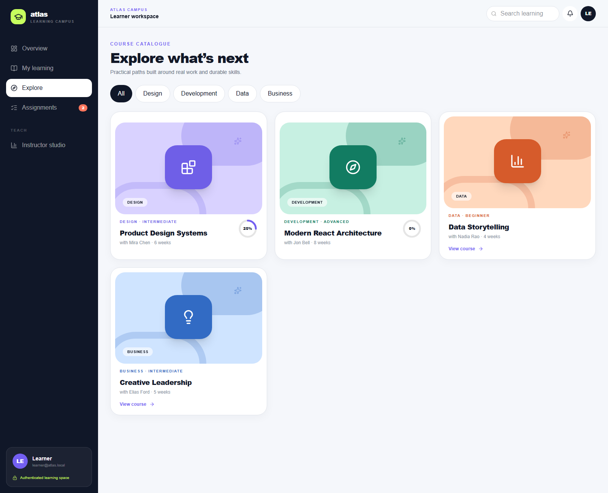
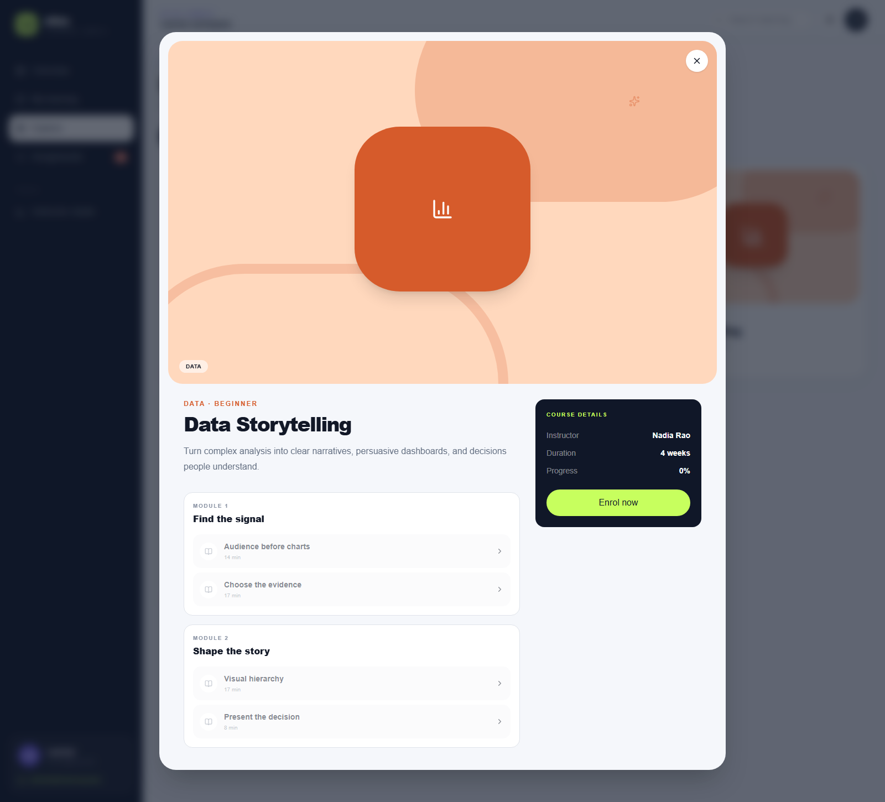
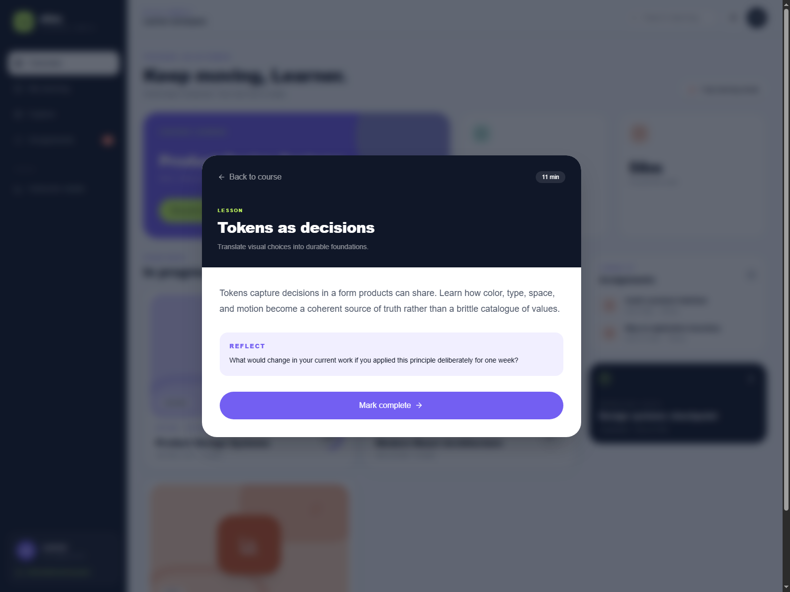
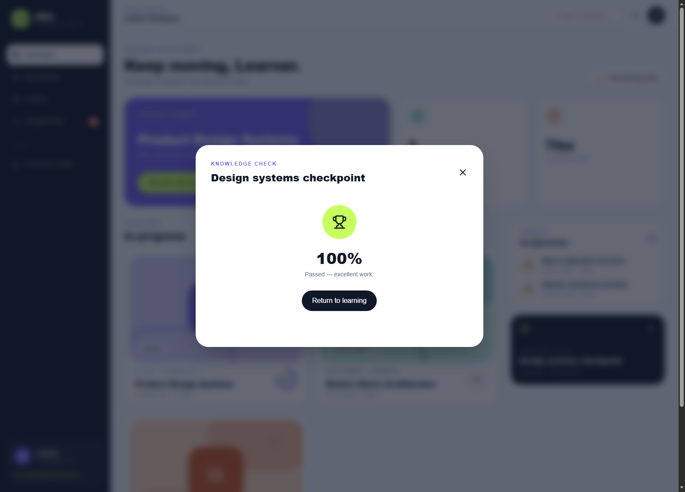
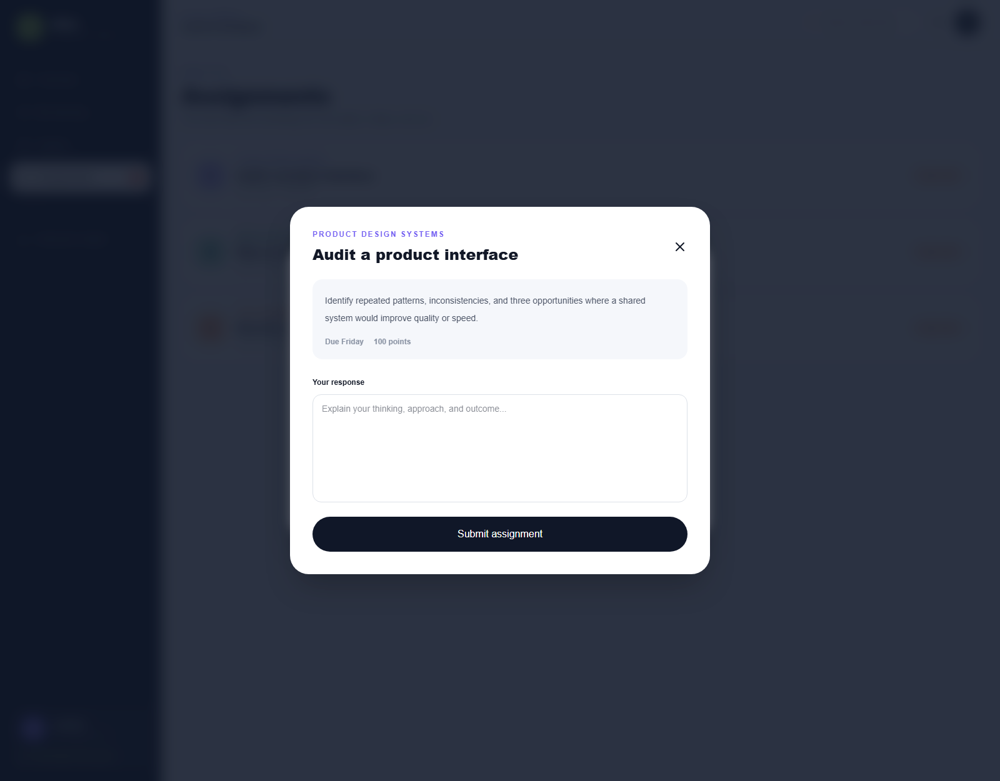
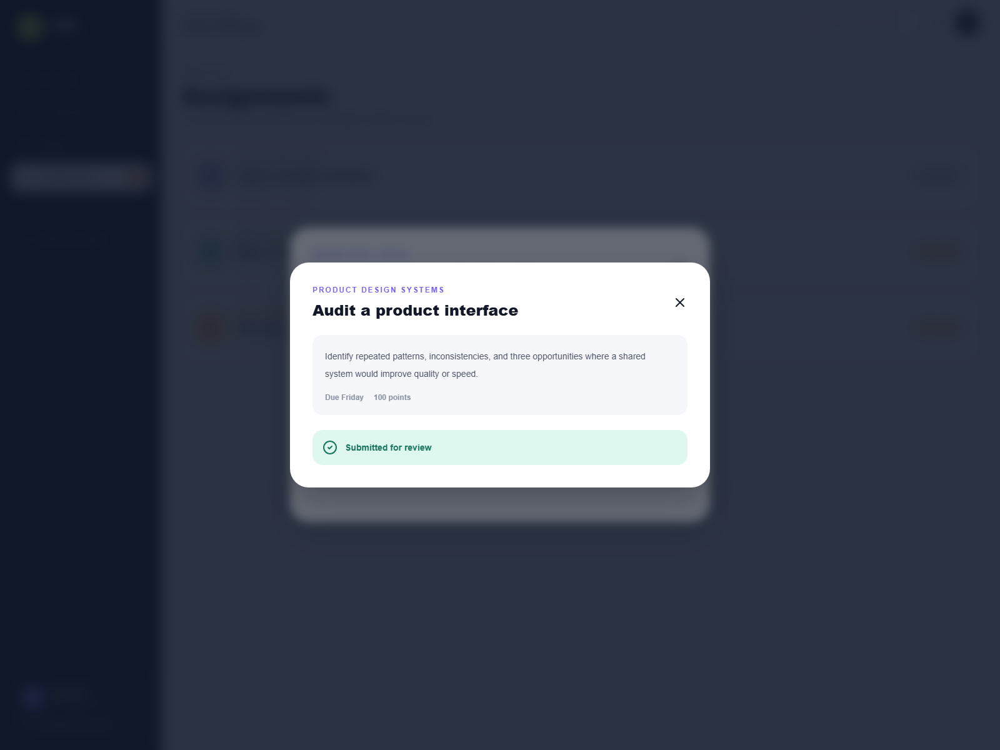
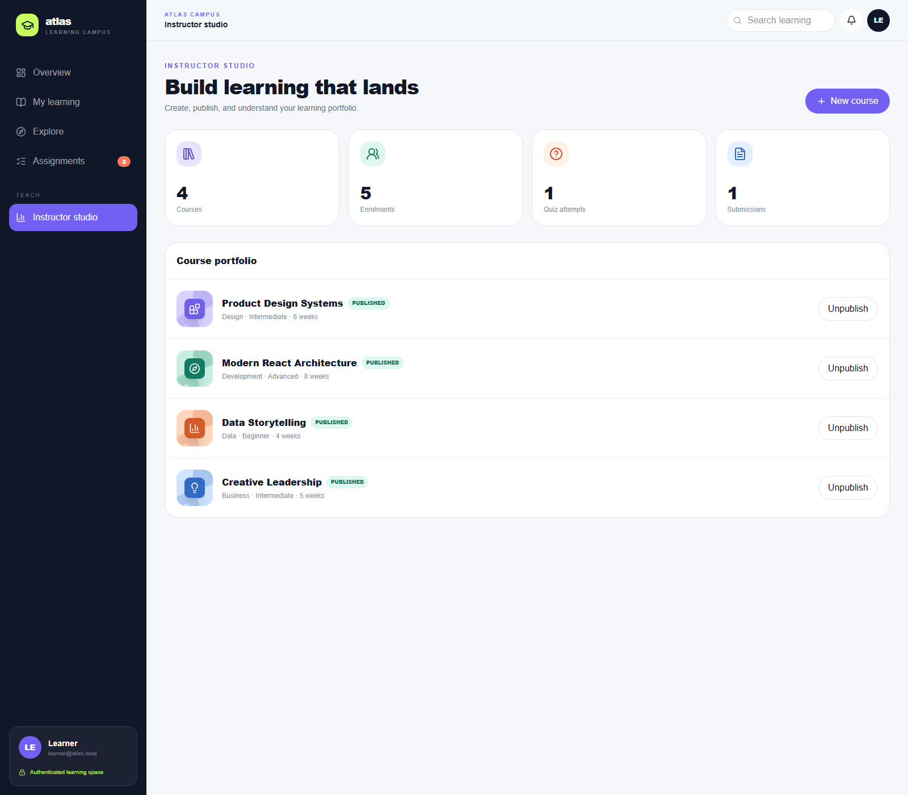
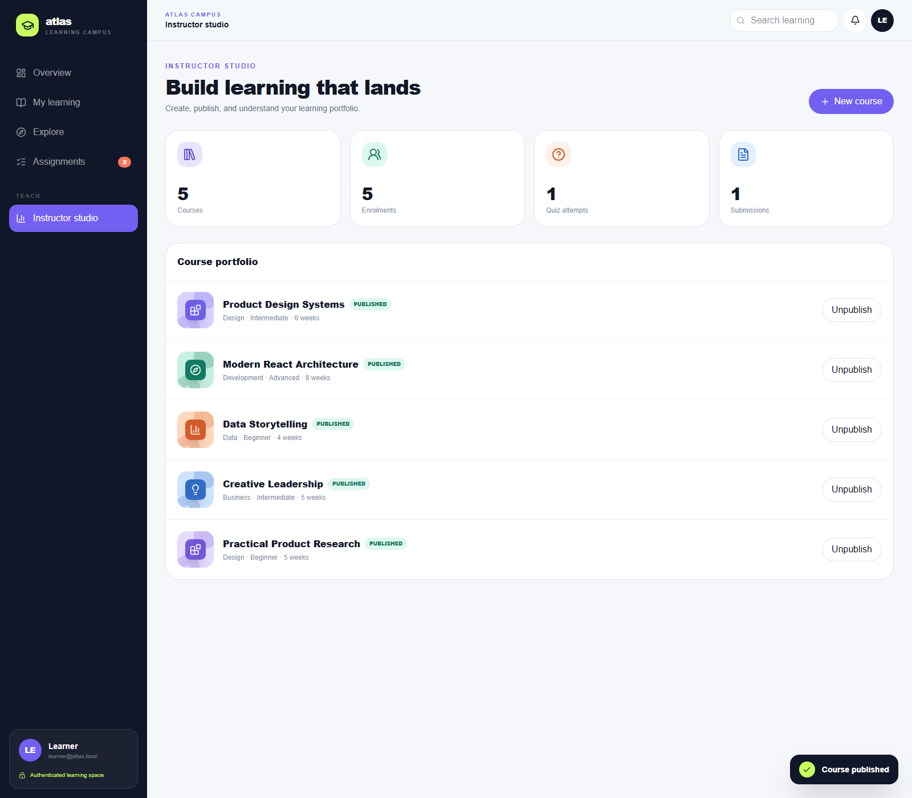

<div align="center">
  
  <h1>Atlas Learning</h1>
  <p><strong>A calmer way to learn, one thoughtful step at a time.</strong></p>
  <p>A full-stack learning management system with a focused learner workspace and an instructor course studio.</p>
</div>

---

## At a glance

Atlas Learning brings courses, lessons, knowledge checks, assignments, and teaching tools into one cohesive experience. Learners can find a course, follow a structured curriculum, track progress, and submit work. Instructors can create courses, publish drafts, and review activity metrics.

| Learner workspace | Instructor studio |
| --- | --- |
| Course catalogue and category discovery | Course portfolio and publication status |
| Enrolments, modules, lessons, and progress | Create a course with a starter module and lesson |
| Knowledge checks with automatic scoring | Publish and unpublish courses |
| Assignment briefs and written submissions | Enrolment, quiz-attempt, and submission metrics |

The interface is responsive and includes a dedicated mobile layout. The [screenshots](screenshots/task-6-atlas-lms/README.md) show the complete Task 6 walkthrough.

## Product tour

<details open>
  <summary><strong>01 — Learner home</strong></summary>
  <br />
  
</details>

<details>
  <summary><strong>02 — Explore courses and curriculum</strong></summary>
  <br />
  
  
</details>

<details>
  <summary><strong>03 — Learn and check understanding</strong></summary>
  <br />
  
  
</details>

<details>
  <summary><strong>04 — Submit an assignment</strong></summary>
  <br />
  
  
</details>

<details>
  <summary><strong>05 — Build and publish a course</strong></summary>
  <br />
  
  
</details>

## Built with

- **React 19** and **TypeScript**
- **Vinext** with a Next-compatible App Router and **Vite**
- **Tailwind CSS 4**
- **Cloudflare Workers** and **D1**
- **Drizzle ORM**
- Password-based accounts with D1-backed, role-aware sessions

The API is organized around account sessions, learner actions, administrator provisioning, and instructor course management:

| Route | Methods | Purpose |
| --- | --- | --- |
| `/api/auth/session` | `GET`, `POST` | Read the current account or sign in |
| `/api/auth/register` | `POST` | Create a learner account after administrator setup |
| `/api/auth/bootstrap` | `POST` | Create the first administrator using a one-time deployment secret |
| `/api/auth/logout` | `POST` | Revoke the current session |
| `/api/admin/users/role` | `PUT` | Let an administrator grant or revoke instructor access |
| `/api/dashboard` | `GET`, `POST` | Load the signed-in learner's data; enrol, complete lessons, submit quizzes, and assignments |
| `/api/instructor` | `GET`, `POST`, `PUT`, `DELETE` | Instructor/admin-only metrics and course management |

## Run locally

### Requirements

- Node.js **22.13 or newer**
- npm

### Install and start

```bash
git clone https://github.com/Abdullah6482/atlas-lms.git
cd atlas-lms
npm install
```

The host-specific `.openai/hosting.json` is intentionally not tracked. Create the local file from the safe template before starting the app:

```powershell
New-Item -ItemType Directory -Force .openai | Out-Null
Copy-Item .openai/hosting.example.json .openai/hosting.json
```

Then start the development server:

```bash
npm run dev
```

Vite runs the app with local Cloudflare bindings. On an empty database, the app initializes fictional course content for the demo. Local runtime and D1 state belong in `.wrangler/` and are excluded from Git. The `start` script serves a production build locally; run `npm run build` first.

Before using a fresh local D1 database, build the Worker config and apply the checked-in SQL migrations in order:

```powershell
npm run build
npx wrangler d1 execute site-creator-d1 --local --file=drizzle/0000_quick_proudstar.sql --config=dist/server/wrangler.json
npx wrangler d1 execute site-creator-d1 --local --file=drizzle/0001_authentication.sql --config=dist/server/wrangler.json
```

Set a local-only bootstrap secret in the ignored `.dev.vars` file before starting the server. Generate a random value rather than reusing a password or committing the secret:

```powershell
node -e "require('node:fs').writeFileSync('.dev.vars', 'AUTH_BOOTSTRAP_SECRET='+require('node:crypto').randomBytes(32).toString('hex')+'\n', {flag:'wx'})"
npm run dev
```

While the server is running, make a same-origin `POST` to `/api/auth/bootstrap` with the header `x-atlas-bootstrap-secret` set to the local secret and a JSON body containing the administrator's `name`, `email`, and a unique password of at least 12 characters. The endpoint succeeds only once and only while the users table is empty. Sign in through the app with that account, then use the admin-only `/api/admin/users/role` endpoint to grant instructor access to learner accounts. New registrations receive the learner role only. Never put real passwords or bootstrap secrets in source control, screenshots, shell history, or public logs.

For a deployed Worker, apply both migrations to its configured D1 database before serving traffic, set `AUTH_BOOTSTRAP_SECRET` with `wrangler secret put AUTH_BOOTSTRAP_SECRET`, and complete the one-time bootstrap over the deployment's HTTPS origin. Remove the bootstrap secret immediately after setup with `wrangler secret delete AUTH_BOOTSTRAP_SECRET`. Cloudflare must serve the app over HTTPS: session cookies are always `Secure`, `HttpOnly`, `SameSite=Lax`, host-only cookies, and unsafe requests must have a matching `Origin`.

### Useful scripts

| Command | Description |
| --- | --- |
| `npm run dev` | Start the local development server |
| `npm run build` | Create the production build |
| `npm run start` | Serve the built app with local Wrangler state |
| `npm run lint` | Run ESLint |
| `npm run db:generate` | Generate Drizzle migrations from the schema |

## Authentication, roles, and demo data

Atlas no longer trusts client-supplied identity headers and has no fixed local demo identity. Passwords are salted and hashed with PBKDF2-HMAC-SHA-256 (600,000 iterations); only hashes of random session tokens are stored in D1. Sessions expire after seven days. The browser only receives the session in a `Secure`, `HttpOnly`, `SameSite=Lax`, host-only cookie. All write routes enforce same-origin requests. Learner records are read and written using the account from the validated session, and lesson, quiz, and assignment actions require enrollment. Quiz answers are not returned to learner clients.

Roles are `learner`, `instructor`, and `admin`. The first administrator is provisioned out-of-band using a secret-protected, atomic, one-time bootstrap endpoint; an absent bootstrap secret never falls back to a default account or credential. Registration remains closed until this administrator exists and can create learners only. Only an administrator can grant instructor permissions, and instructor/admin checks are enforced by the API in addition to the UI.

This implementation provides account authentication and access control, but it does not yet include email verification, password reset/recovery, multi-factor authentication, or login/signup rate limiting. Review those needs, configure Cloudflare HTTPS, apply migrations, provision the first administrator securely, and add appropriate operational monitoring before production use.

Course catalogue content is fictional seed data. The screenshots include synthetic interactions and do not depict real accounts, a production database, or a live deployment. No local D1 database or runtime state is included in this repository.

## Deploy to Cloudflare Workers

The public repository uses `.openai/hosting.example.json` automatically when the ignored `.openai/hosting.json` is absent, so Cloudflare can build it without private workstation configuration. The example contains only the D1 binding name; production database IDs are supplied at deploy time and are never committed.

1. In Cloudflare, create a **D1 database** named `atlas-lms` (or choose another name and use it consistently). Copy its database ID.
2. In the Worker build settings, use Node.js `22.13` or newer, set the build command to `npm run build`, and the deploy command to `npm run deploy`. Turn off preview builds until a separate preview D1 database is configured.
3. Add these build environment variables:
   - `CLOUDFLARE_D1_DATABASE_ID`: the D1 database ID copied from Cloudflare. This is an identifier, not a credential.
   - `CLOUDFLARE_D1_DATABASE_NAME`: the database name, for example `atlas-lms`.
4. Before the first deploy, apply the schema from a local checkout that is authenticated with Wrangler. In PowerShell, after `npm ci` and `npm run build`, set the same two variables and run `npm run db:migrate:remote`:

   ```powershell
   $env:CLOUDFLARE_D1_DATABASE_NAME = "atlas-lms"
   $env:CLOUDFLARE_D1_DATABASE_ID = "paste-the-database-id-from-cloudflare"
   npx wrangler login
   npm run db:migrate:remote
   ```

   This applies the checked-in migrations in order to the named **remote** database; review the target name and ID before running it. The database ID is not a password, but keep credentials and bootstrap secrets out of source control.
5. Add `AUTH_BOOTSTRAP_SECRET` as a Cloudflare Worker secret, deploy, then use the one-time bootstrap endpoint from the HTTPS site to create the first administrator. Remove `AUTH_BOOTSTRAP_SECRET` from Worker secrets immediately after successful setup.
6. Open the HTTPS Worker URL, sign in with the administrator account, register a fictional learner, and verify that learner and instructor actions are properly restricted before sharing the demo link.

The deploy command refuses to run if the D1 database ID is missing or invalid, or the generated Worker config has no `DB` binding. The production database ID only modifies the generated file under `dist/`; it does not change tracked source files. Keep preview deployments disabled unless you create a separate D1 database and configure its ID for the preview environment.

## Project structure

```text
app/
  api/                 Learner and instructor API routes
  api/auth-session.ts  Password and session helpers
  page.tsx             Learning workspace and instructor studio
db/                    Drizzle schema and D1 binding
drizzle/               SQL migrations and schema snapshots
lib/                   Connector contracts and shared helpers
public/                Static assets
screenshots/            Product overview and Task 6 evidence
worker/                 Cloudflare Worker entry point
```

## Project context

Built for **Task 6 — Learning Management System (Advanced)** as part of the Auspify Technologies Full Stack Development internship. Atlas Learning is an educational project and is not presented as a deployed commercial service.
